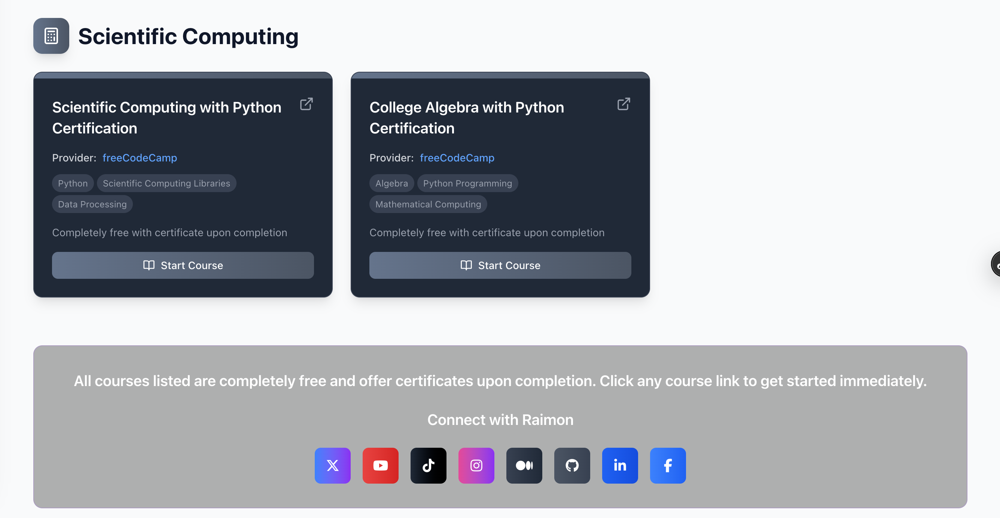

# Free Software Development Courses with Certificates

A curated, regularly verified collection of free software development courses. Every course says honestly what you get when you finish: a certificate, a badge, a trophy, or a free course that prepares for a paid exam. 27 current courses (plus 11 legacy ones) from freeCodeCamp, Microsoft Learn, AWS and Google, organised by topic.

## 🌐 Live Demo

**[🚀 Visit Free Courses Website](https://courses-free-with-certificate.vercel.app)**



## ✨ Features

- **27 current free courses** in 10 categories, plus 11 legacy freeCodeCamp certifications (hidden by default, each with a link to its new version)
- **Honest labels**: *Free certificate*, *Free badge*, *Free trophy* or *Free course · paid exam* on every card
- **Search** by title, provider or topic, and **filter** by what you receive
- **Last verified** date on the page; every link, price and credential checked on 2026-10-28
- **Weekly link check**: a GitHub Action checks every course URL and opens an issue when one breaks
- **Dark mode** toggle that follows your system setting by default
- **Responsive**: phone, tablet and desktop

## 🚀 Getting Started

### Prerequisites

- Node.js 20+ 
- pnpm (recommended) or npm/yarn

### Installation

1. Clone the repository:
```bash
git clone https://github.com/raimonvibe/courses-free-with-certificate.git
cd courses-free-with-certificate
```

2. Install dependencies:
```bash
pnpm install
# or
npm install
```

3. Run the development server:
```bash
pnpm dev
# or
npm run dev
```

4. Open [http://localhost:3000](http://localhost:3000) in your browser

## 🛠️ Tech Stack

- **Framework**: Next.js 15 with App Router
- **Language**: TypeScript
- **Styling**: Tailwind CSS v4
- **Icons**: Lucide React
- **Fonts**: Geist Sans & Geist Mono
- **Deployment**: Vercel (recommended)

## 📚 Course Categories

Frontend Development · Backend Development · Security & Cybersecurity · Data Science & Visualization · Cloud Computing · DevOps · Database Management · Machine Learning & AI · Digital Marketing · Career Skills

## ➕ Adding or updating a course

All courses live in **`src/data/courses.ts`**; the page only renders that file. Add an entry with:

- `credential`: `certificate`, `badge`, `trophy` or `paid-exam` (be honest: Microsoft Learn paths give a trophy, not a certificate)
- `status`: `current`, or `legacy` with a `successor` link when a provider replaces a course
- `lastVerified`: the day you checked the link and the price yourself

The weekly link check (`.github/workflows/link-check.yml`) reads the URLs from that file automatically.

## 🌙 Dark Mode

The website includes a fully functional dark mode toggle that:
- Persists user preference in localStorage
- Respects system color scheme preference
- Smoothly transitions between themes
- Updates all UI components consistently

## 🔗 Course Providers

Courses are sourced from reputable providers including:
- freeCodeCamp
- Microsoft Learn
- AWS Skill Builder
- IBM SkillsBuild
- Coursera
- edX
- And more...

## 📱 Responsive Design

The website is fully responsive and optimized for:
- Desktop computers
- Tablets
- Mobile devices
- Various screen sizes and orientations

## 🚀 Deployment

### Deploy on Vercel (Recommended)

1. Push your code to GitHub
2. Connect your repository to [Vercel](https://vercel.com)
3. Deploy with zero configuration

### Other Platforms

The website can be deployed on any platform that supports Next.js:
- Netlify
- Railway
- DigitalOcean App Platform
- AWS Amplify

## 🤝 Contributing

Contributions are welcome! Please feel free to submit a Pull Request. For major changes, please open an issue first to discuss what you would like to change.

## 📄 License

This project is licensed under the MIT License - see the [LICENSE](LICENSE) file for details.

## 👨‍💻 Author

Created by [Raimon Baudoin](https://github.com/raimonvibe) (@raimonvibe)

---

**Start your learning journey today with completely free courses that offer certificates upon completion!**
